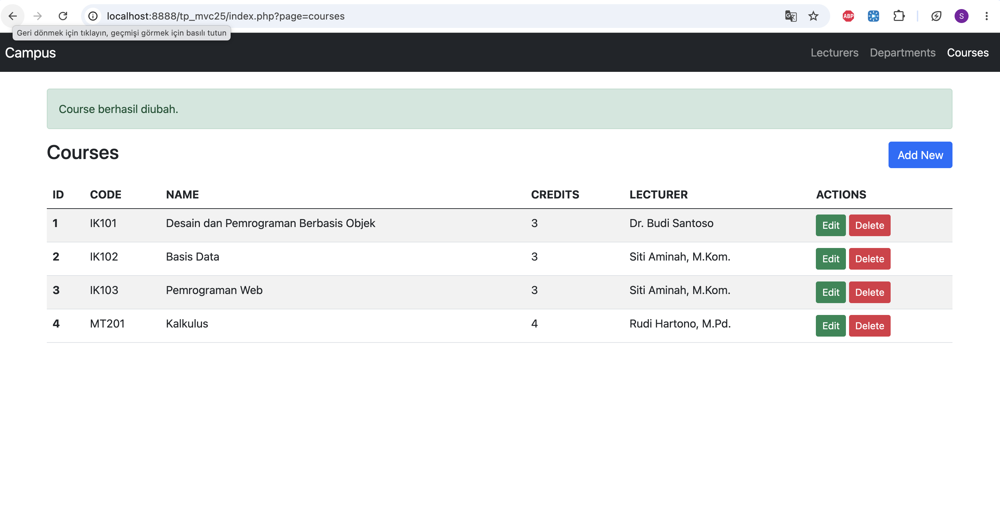
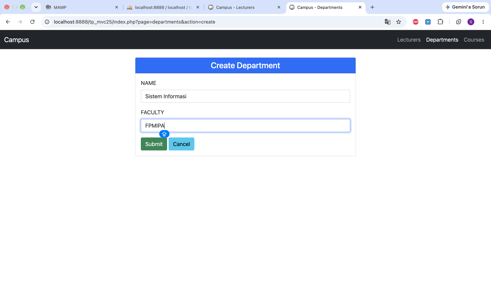
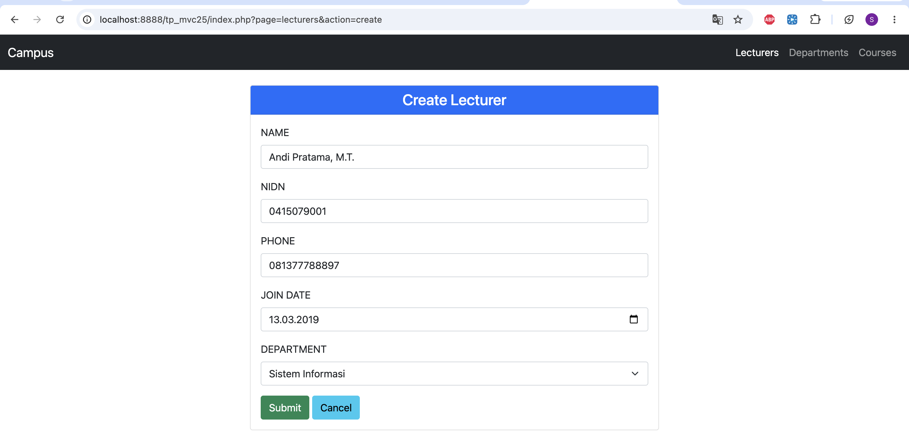
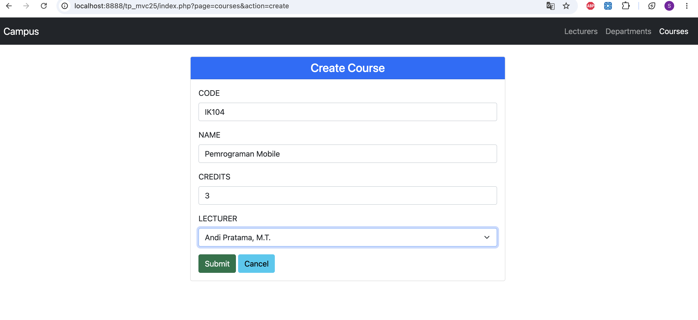
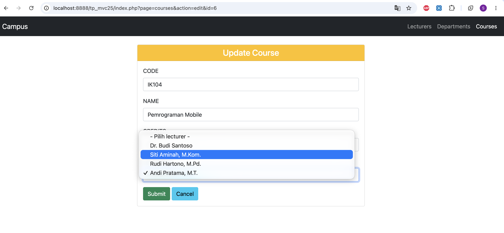

# TP8 DPBO 2425 - Campus (PHP MVC)

Ini adalah tugas praktikum untuk mengubah project CRUD Lecturers menjadi arsitektur MVC. Selain itu saya menambahkan 2 tabel baru yaitu `departments` dan `courses`, lengkap dengan CRUD-nya.

## Desain Database

Ada 3 tabel:

- `departments` (id, name, faculty)
- `lecturers` (id, name, nidn, phone, join_date, department_id)
- `courses` (id, code, name, credits, lecturer_id)

Relasinya:
- Satu department bisa punya banyak lecturer.
- Satu lecturer bisa mengajar banyak course.

Di tabel `lecturers` saya menambah kolom `department_id`.

## Struktur Project

```
Project/
├── index.php
├── config/database.php
├── models/
│   ├── Lecturer.php
│   ├── Department.php
│   └── Course.php
├── controllers/
│   ├── BaseController.php
│   ├── LecturerController.php
│   ├── DepartmentController.php
│   └── CourseController.php
├── views/
│   ├── layout/ (header dan footer)
│   ├── lecturers/
│   ├── departments/
│   └── courses/
└── assets/
```

- **Model**: mengurus query ke database.
- **View**: file tampilan HTML.
- **Controller**: menerima request dari user, ambil data dari model, lalu kirim ke view.

## Alur Program

Contohnya saat user membuka `index.php?page=courses&action=create`:

1. `index.php` membaca `page` dan `action` dari URL, lalu memanggil `CourseController` dan method `create()`.
2. Controller mengambil daftar lecturer lewat model `Lecturer`.
3. Controller mengirim data itu ke view `courses/form.php`.
4. Saat form di-submit, controller memanggil model `Course` untuk menyimpan data ke database, lalu kembali ke halaman daftar course.

Edit dan delete alurnya sama, hanya method-nya yang berbeda.

## Cara Menjalankan (MAMP)

1. Copy isi folder `Project` ke `/Applications/MAMP/htdocs/tp_mvc25/`.
2. Jalankan MAMP (klik Start).
3. Buka phpMyAdmin, lalu import file `Database/tp_mvc25.sql`.
4. Buka `localhost:8888/tp_mvc25/` di browser.

Pengaturan koneksi database ada di `Project/config/database.php` (user root, password root, port 8889).

## Dokumentasi

Daftar Course



Tambah Department



Tambah Lecturer



Tambah Course



Edit Course


